# VendorBridge — Procurement & Vendor Management ERP
> **Current Milestone:** Week 2 — RFQ & Quotation Management (Built on Week 1 Foundation)  
> **Repository:** `VendorBridge-X-Kagnus`  
> **Source of Truth:** VendorBridge 11-Screen Excalidraw Specification

[](https://www.typescriptlang.org/)
[](https://nodejs.org/)
[](https://react.dev/)
[](https://tailwindcss.com/)
[](https://www.prisma.io/)
[](https://www.postgresql.org/)
[](https://vitest.dev/)

---

## 1. Executive Summary

**VendorBridge** is an enterprise-grade Procurement & Vendor Management ERP designed to streamline the entire source-to-pay lifecycle. Following the canonical 11-screen Excalidraw specification, the project is structured into 4 sequential milestone weeks:

- **Week 1:** Authentication, Role-Based Access Control, Role-Aware Dashboard, and Complete Vendor Management.
- **Week 2 (Current):** Request for Quotation (RFQ) Lifecycle, Vendor Portal Quotation Submission, and Quotation Comparison Matrix with Lowest-Price Highlighting.
- **Week 3:** Multi-Level Approval Workflows & Manager Sign-offs.
- **Week 4:** Purchase Orders, 3-Way Matching Invoices, and Analytics.

### Week 2 Deliverables:
1. **RFQ Creation & Lifecycle (Screen 5):**
   - Atomic concurrency-safe sequence generator `RFQ-YYYY-NNNN` using PostgreSQL `Counter` table.
   - 3-step section layout: General Details, Items & Quantities dynamic editor, and Vendor Assignment checklist with category filters and ratings.
   - Dual-action workflows: Save as Draft or Publish immediately (with validation: ≥1 line item, ≥1 active vendor, and future deadline).
   - Lifecycle state transitions: `DRAFT → OPEN → CLOSED → QUOTATION_SELECTED → CANCELLED` with optimistic concurrency control (`version`).
2. **Vendor Portal Quotation Submission (Screen 6):**
   - Dedicated vendor workspace (`/vendor-portal/rfqs/:id/quote`) for invited vendors.
   - Strict object-level security: unassigned vendors receive `404 Not Found` (preventing ID leakage).
   - Real-time line item pricing with delivery days and live calculated totals.
   - Pure domain financial calculations via `Prisma.Decimal` and `ROUND_HALF_UP` to 2 decimal places (BR-7).
   - Strict deadline enforcement: submissions automatically lock once the deadline passes (BR-4).
   - Complete bid requirement (BR-6) and snapshot revision history tracking.
3. **Quotation Comparison Matrix (Screen 7):**
   - Side-by-side vendor evaluation matrix showing pricing, commercial terms, delivery timelines, and vendor ratings.
   - **Lowest Price Highlighting (BR-10):** Prominent green badge and border marking the lowest valid comparable quotation (L1) and lowest unit prices per line item.
   - Multi-parameter sorting (Price, Delivery Days, Rating, Submission Date) and filtering (Max Price, Max Days, Min Rating).
   - One-click winning quotation selection with optimistic locking and status transition to `QUOTATION_SELECTED`.

---

## 2. Technology Stack

| Layer | Technology | Purpose |
|---|---|---|
| **Frontend** | React 18, Vite, TypeScript | Fast reactive SPA with strict type safety |
| **Styling** | Vanilla Tailwind CSS (Custom Dark Theme Tokens) | Exact visual match to dark Excalidraw mockup with `#0B0D0C` canvas and emerald `#15803D` accents |
| **Data Fetching** | TanStack Query v5 + Axios | Automatic caching, query invalidation, background refetching, and 401 refresh interceptor |
| **Form Handling** | React Hook Form + Zod | Schema-driven client validation matching backend DTO schemas |
| **Routing** | React Router v6 | Protected routes, role guards, nested layouts |
| **Backend API** | Node.js 20+, Express, TypeScript | Modular REST API with centralized error handling |
| **Database & ORM** | PostgreSQL (v16/18) + Prisma ORM | Relational persistence, migrations, and foreign keys |
| **Auth & Security** | Argon2id, JWT, httpOnly Cookies, Helmet, Rate-Limit | Secure session handling without exposing tokens to JavaScript |
| **Audit Log** | Prisma insert-only `AuditLog` service | Forensic traceability for all vendor, RFQ, and quotation events |
| **Testing** | Vitest, Supertest | 48 integration and unit tests passing |

---

## 3. Architecture & Role-Based Access Matrix

```
                    ┌─────────────────────────┐
                    │ React 18 + Vite Client  │
                    │  (Port 5173 / 5174)     │
                    └────────────┬────────────┘
                                 │ HTTP / httpOnly Cookies
                                 ▼
                    ┌─────────────────────────┐
                    │ Express TypeScript API  │
                    │       (Port 4000)       │
                    └────────────┬────────────┘
         ┌───────────────────────┼───────────────────────┐
         ▼                       ▼                       ▼
┌──────────────────┐    ┌──────────────────┐    ┌──────────────────┐
│  Auth Middleware │    │ RBAC Permissions │    │ Central Error    │
│  & Cookie Parser │    │   Enforcement    │    │ & Audit Service  │
└──────────────────┘    └──────────────────┘    └──────────────────┘
                                 │
                                 ▼
                    ┌─────────────────────────┐
                    │  Prisma ORM Client      │
                    └────────────┬────────────┘
                                 │ SQL Connection Pool
                                 ▼
                    ┌─────────────────────────┐
                    │ PostgreSQL Database     │
                    │ (Tables: User, Session, │
                    │  Vendor, Rfq, Quotation,│
                    │  QuotationItem, Counter)│
                    └─────────────────────────┘
```

### Role-Based Access Control (RBAC) Matrix

| Endpoint | Action | Admin | Procurement Officer | Manager | Vendor | Anonymous |
|---|---|:---:|:---:|:---:|:---:|:---:|
| `GET /api/v1/auth/me` | Current Profile | 200 | 200 | 200 | 200 | 401 |
| `GET /api/v1/dashboard/summary` | Dashboard Stats | 200 | 200 | 200 | 200 | 401 |
| `GET /api/v1/vendors` | List Vendors | 200 | 200 | 200 | **403** | 401 |
| `POST /api/v1/vendors` | Create Vendor | 201 | 201 | **403** | **403** | 401 |
| `GET /api/v1/rfqs` | List RFQs | 200 | 200 | 200 | **403** | 401 |
| `POST /api/v1/rfqs` | Create RFQ | 201 | 201 | **403** | **403** | 401 |
| `GET /api/v1/rfqs/:id` | View RFQ Detail | 200 | 200 | 200 | **403** | 401 |
| `PUT /api/v1/rfqs/:id` | Update RFQ | 200 | 200 | **403** | **403** | 401 |
| `POST /api/v1/rfqs/:id/publish` | Publish RFQ | 200 | 200 | **403** | **403** | 401 |
| `POST /api/v1/rfqs/:id/close` | Close RFQ | 200 | 200 | **403** | **403** | 401 |
| `POST /api/v1/rfqs/:id/cancel` | Cancel RFQ | 200 | 200 | **403** | **403** | 401 |
| `GET /api/v1/rfqs/:id/comparison` | Compare Quotations | 200 | 200 | 200 | **403** | 401 |
| `PUT /api/v1/rfqs/:id/selection` | Select Winning Quote | 200 | 200 | **403** | **403** | 401 |
| `GET /api/v1/vendor-portal/rfqs` | My Assigned RFQs | **403** | **403** | **403** | 200 | 401 |
| `GET /api/v1/vendor-portal/rfqs/:id` | View Assigned RFQ | **403** | **403** | **403** | 200 | 401 |
| `PUT /api/v1/vendor-portal/rfqs/:id/quotation` | Submit / Edit Quote | **403** | **403** | **403** | 200 | 401 |

---

## 4. Database Schema & Entities

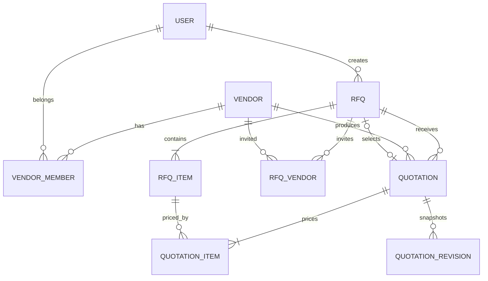

---

## 5. Seed Demo Accounts & Quick Login

The database includes 4 pre-configured demo user accounts with 1-click login buttons on the login screen (`Password@123` for all):

| Role | Email | Password | Access Capabilities |
|---|---|---|---|
| **Admin** | `admin@vendorbridge.local` | `Password@123` | Full ERP permissions, vendor delete, RFQ lifecycle, quotation selection |
| **Procurement Officer** | `officer@vendorbridge.local` | `Password@123` | Vendor create/update, RFQ create/publish/close/reopen, quotation comparison & selection |
| **Manager** | `manager@vendorbridge.local` | `Password@123` | View dashboard, vendors, RFQs, and quotation comparison matrices |
| **Vendor Representative** | `vendor@vendorbridge.local` | `Password@123` | Linked to **Apex Technologies Solutions**; submits quotations, edits bids before deadline |

---

## 6. Installation & Running Instructions

### Prerequisites
- **Node.js**: v20 or higher
- **PostgreSQL**: v16 or v18 running locally on port `5432`

### 1. Clone & Configure Environment
```bash
git clone https://github.com/aadarsh2006ak/VendorBridge-X-Kagnus.git
cd VendorBridge-X-Kagnus

# Copy environment variables
cp server/.env.example server/.env
cp client/.env.example client/.env
```

### 2. Database Migration & Seed
```bash
cd server
npm install
npm run db:migrate
npm run db:seed
```

### 3. Start Development Servers
In two separate terminals:

```bash
# Terminal 1 - Backend API (Port 4000)
cd server
npm run dev

# Terminal 2 - Frontend Client (Port 5173)
cd client
npm run dev
```

Open **`http://localhost:5173`** in your browser.

---

## 7. Automated Testing

Run the Vitest test suite from `server/`:

```bash
cd server
npm test
```

### Test Results Summary:
```
 ✓ src/modules/quotations/__tests__/quotation.calculator.test.ts (2 tests)
 ✓ src/modules/vendors/__tests__/vendor-features.test.ts (7 tests)
 ✓ src/modules/auth/__tests__/auth.test.ts (14 tests)
 ✓ src/modules/vendors/__tests__/vendor-rbac-matrix.test.ts (25 tests)

 Test Files  4 passed (4)
      Tests  48 passed (48)
```

---

## 8. Demonstrable Evidence & Screenshots

> 📁 **Screenshot Repository Gallery:** [`docs/screenshots/`](docs/screenshots/)

| # | Screenshot | Screen / Workflow | Preview |
|---|---|---|:---:|
| 01 | `01-login.png` | Dark login screen with 1-click demo accounts | 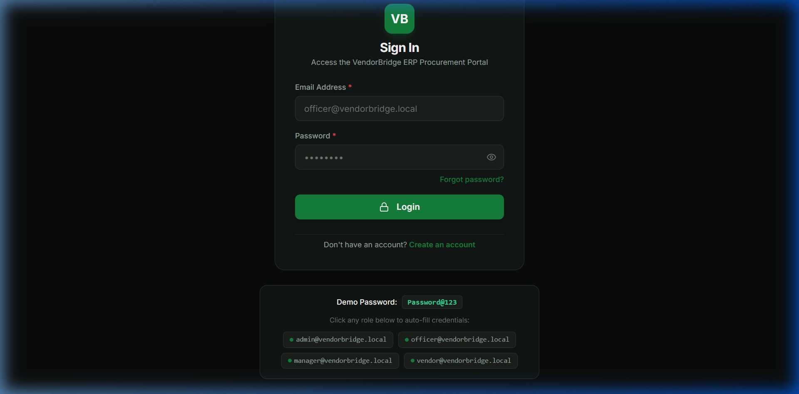 |
| 02 | `02-dashboard.png` | Role-aware dashboard with live database stats | 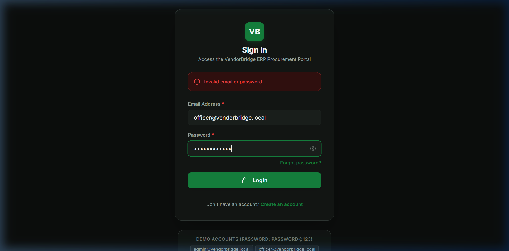 |
| 03 | `03-vendors-list.png` | Screen 4: Complete vendor table with search and filters | 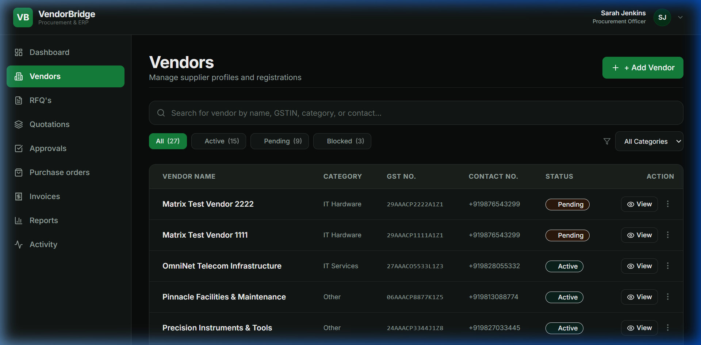 |
| 04 | `04-add-vendor-modal.png` | Add vendor modal form with GSTIN validation | 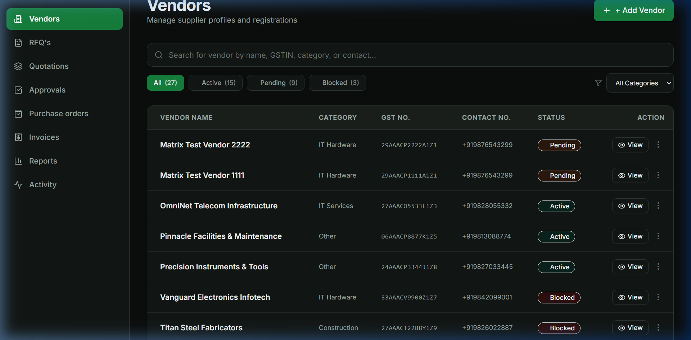 |
| 05 | `05-vendors-filtered.png` | Filtered vendor list with dynamic count chips | 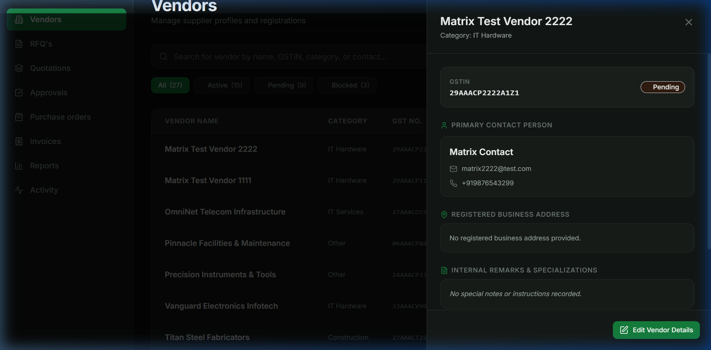 |
| 06 | `06-vendor-created.png` | Newly created vendor persisted in database | 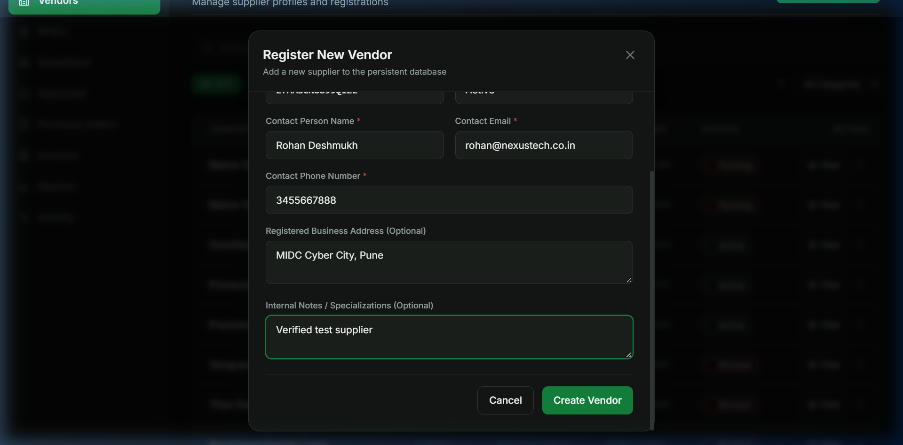 |
| 07 | `07-rfqs-list.png` | RFQ listing table with status filter tabs & count chips | 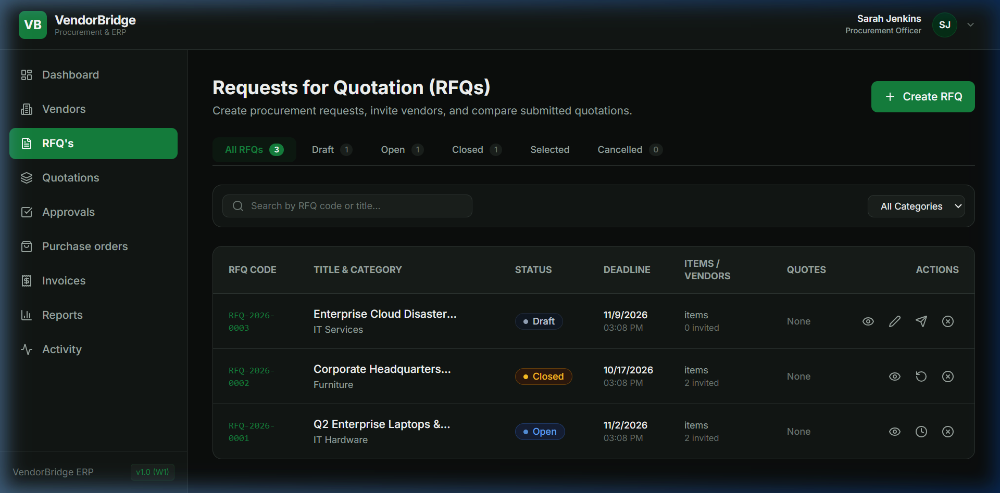 |
| 08 | `08-create-rfq-general-items.png` | Screen 5: RFQ creation (Section 1 Details & Section 2 Items) | 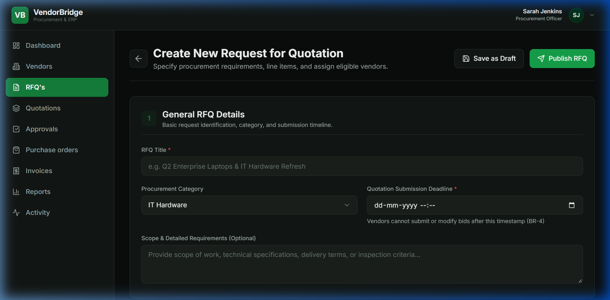 |
| 09 | `09-create-rfq-vendor-assignment.png` | Screen 5: RFQ creation (Section 3 Vendor Assignment) | 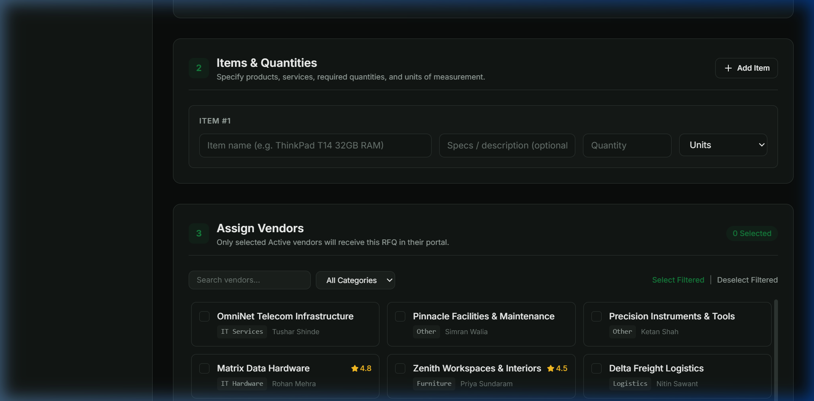 |
| 10 | `10-rfq-details-view.png` | RFQ details view with line items & vendor invitation status | 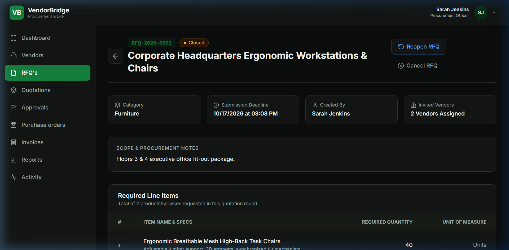 |
| 11 | `11-vendor-portal-rfqs.png` | Vendor Portal assigned RFQs & submission deadlines | 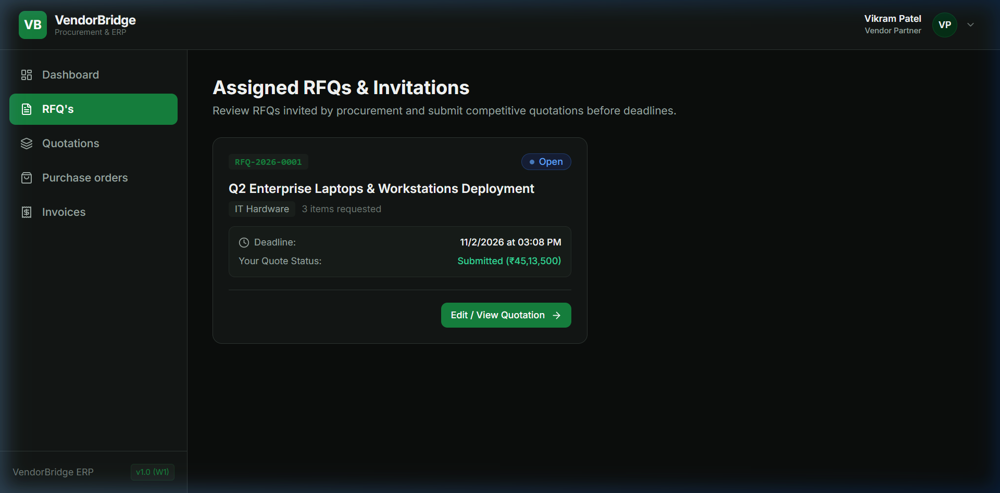 |
| 12 | `12-vendor-quote-submission.png` | Screen 6: Vendor quotation pricing workspace | 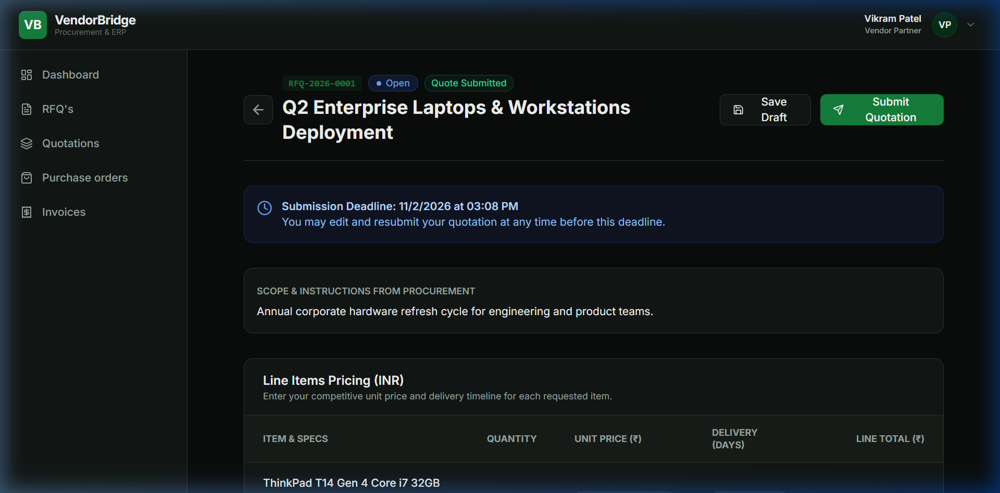 |
| 13 | `13-vendor-quote-calculations.png` | Screen 6: Live calculations (Subtotal, GST, Grand Total) | 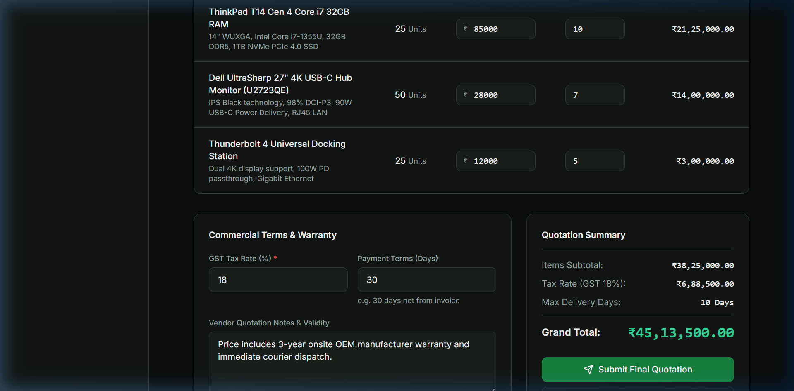 |
| 14 | `14-quotation-comparison-matrix.png` | Screen 7: Quotation Comparison Matrix & Lowest Price (L1) | 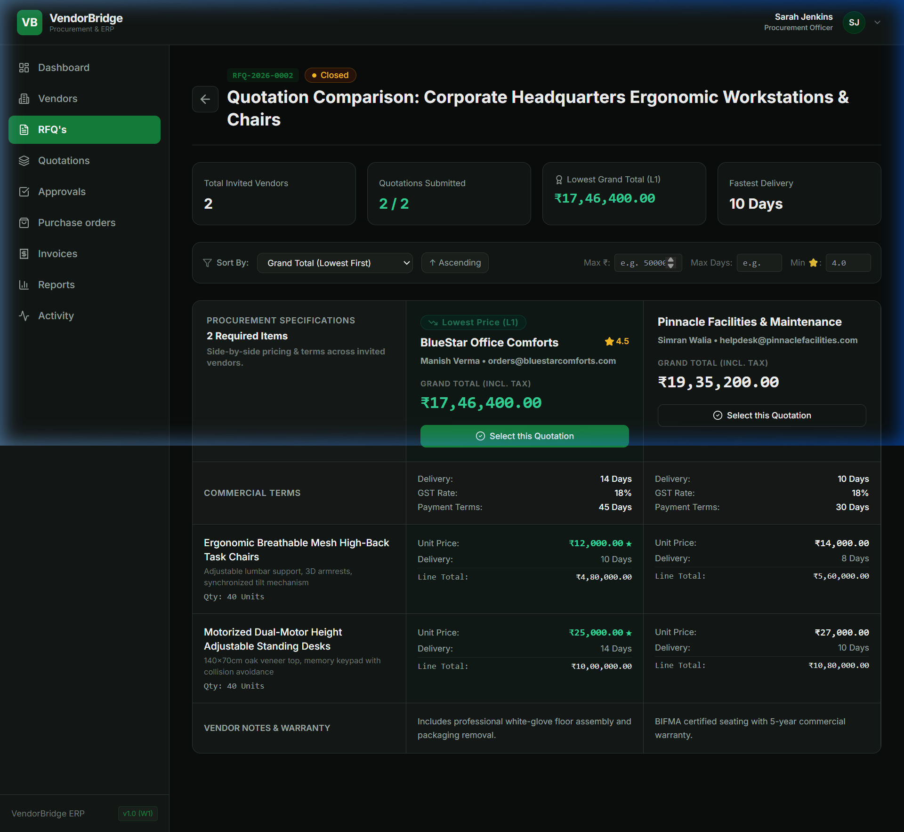 |

---

## 9. Milestone Acceptance Checklist

- [x] **Week 1 Foundation**
  - [x] Secure authentication with argon2id, JWT rotation, and httpOnly cookies.
  - [x] Role-Based Access Control matrix verified by 25 automated tests.
  - [x] Complete vendor management CRUD with Indian GSTIN validation.
- [x] **Week 2: RFQ Lifecycle (Screen 5)**
  - [x] Concurrency-safe sequence generator `RFQ-YYYY-NNNN`.
  - [x] 3-step section layout: General Details, Items & Quantities, Vendor Assignment.
  - [x] Save as Draft & direct Publish actions.
  - [x] Optimistic concurrency control using `version`.
  - [x] State transitions (Draft, Open, Closed, Quotation Selected, Cancelled).
- [x] **Week 2: Vendor Portal (Screen 6)**
  - [x] Vendor-safe assigned RFQ view (`404` for unassigned RFQs).
  - [x] Live decimal calculations (Subtotal, GST, Grand Total).
  - [x] Strict deadline enforcement (auto-locks after deadline).
  - [x] Revisions snapshot tracking on quote modification.
- [x] **Week 2: Quotation Comparison (Screen 7)**
  - [x] Side-by-side vendor quotation comparison matrix.
  - [x] Green lowest price (L1) badge & highlight.
  - [x] Multi-parameter sorting and filtering.
  - [x] Winning quotation selection with RFQ status transition.

---

*VendorBridge is developed for the 4-week Full Stack ERP Internship Milestone.*
