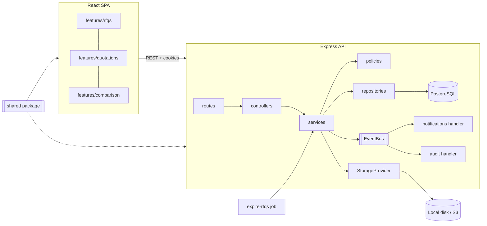
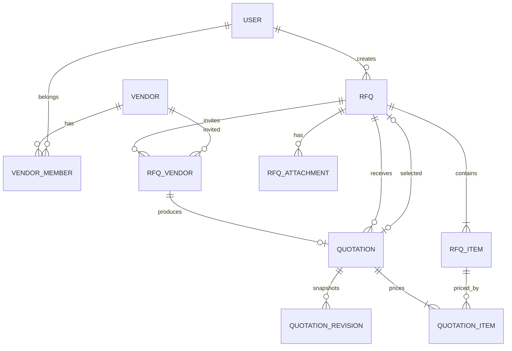
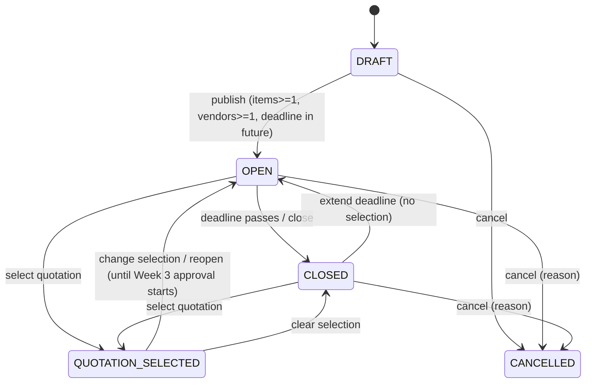

# VendorBridge — Architecture (Week 2)

Extends the Week 1 architecture (React + Vite + TS, Express + TS, PostgreSQL + Prisma, cookie JWT sessions, Zod). Nothing in Week 1 is replaced; Week 2 adds modules and introduces the structural patterns that keep Weeks 3–4 cheap.

## 1. What Changes in Week 2

| Area | Week 1 | Week 2 |
|---|---|---|
| Repo layout | `client/`, `server/` | Add `shared/` workspace (`@vendorbridge/shared`) |
| Validation | Duplicated Zod schemas per side | Single schemas in `shared/`, imported by both |
| Server layering | routes → controller → service → prisma | + **repository** layer, **policy** layer, **mapper** (DTO) layer |
| Module coupling | Informal | Enforced boundaries (`dependency-cruiser`), public `index.ts` per module |
| Side effects | Inline | **Domain events** (in-process, queue-ready) |
| Files | None | **Storage abstraction** (local ↔ S3-compatible) |
| Time | `new Date()` | Injected **Clock** |
| Background work | None | One locked interval job (expire RFQs) |
| Quality gates | Local lint/tests | **CI** pipeline + coverage and boundary checks |

## 2. Maintainability and Scalability Principles

These are binding design constraints, each with a concrete mechanism.

| # | Principle | Mechanism |
|---|---|---|
| P1 | **Modular monolith** — strong boundaries now, extractable later | One folder per domain module; only `index.ts` is importable from outside; cross-module calls go through exported functions or domain events; `dependency-cruiser` fails CI on violations and cycles |
| P2 | **One source of truth for contracts** | `shared/` holds enums, limits, Zod schemas, DTO types, error codes, permission map, state machines, totals calculator |
| P3 | **Thin edges, rich core** | Controllers only parse/respond. Business rules live in services + pure domain functions (`state-machine`, `totals`, `comparison`) that are unit-testable without DB or HTTP |
| P4 | **Data access in one place** | Only `*.repository.ts` imports Prisma; services receive repositories (constructor injection) → tests can fake them; query shapes are explicit (`select`) |
| P5 | **Authorization as policy, not scattered ifs** | `permissions.ts` (role → capability) + `*.policy.ts` (object-level rules) + repository **scoping helpers** so unauthorized rows are never fetched |
| P6 | **State changes via explicit state machines** | Transition tables as data; invalid transition → `409 INVALID_STATE_TRANSITION`; Week 3 extends the table instead of rewriting logic |
| P7 | **Audience-specific DTOs** | Mappers produce `RfqOfficerDto` vs `RfqVendorDto`; vendor view omits other vendors, other quotes, internal fields. Entities never leave the service layer |
| P8 | **Integrity in the database too** | Composite foreign keys, unique and CHECK constraints (see §4.3) — service bugs cannot create unrelated links |
| P9 | **Concurrency-safe writes** | `version` column + optimistic locking; transactions; deadline checks inside the transaction; advisory lock for jobs |
| P10 | **Side effects are decoupled and non-fatal** | Domain events → handlers (email, audit). Failures are logged, never fail the request; the seam allows a real queue later |
| P11 | **Swap infrastructure without touching domain code** | `StorageProvider`, `Mailer`, `Clock`, `EventBus` interfaces |
| P12 | **Stateless API** | No in-memory session/state; cookies + DB; safe behind a load balancer |
| P13 | **Predictable, bounded queries** | Pagination everywhere, max limits, documented indexes, no N+1 (query-count tests), `EXPLAIN` checked for list/comparison |
| P14 | **Decisions are written down** | ADRs in `docs/adr/` (see §13) |

## 3. System and Module Map



### Server modules and allowed dependencies

```
modules/
  auth/            (Week 1)
  users/           (Week 1)
  vendors/         (Week 1 + members + rating)
  rfqs/            NEW  RFQ aggregate: items, vendor assignments, lifecycle, selection
  quotations/      NEW  Quotation aggregate: items, revisions, totals, submit/edit
  comparison/      NEW  read model: builds comparison DTO from quotations (no writes)
  attachments/     NEW  upload/download/delete via StorageProvider
  vendor-portal/   NEW  vendor-facing controllers; delegates to rfqs + quotations public APIs
  dashboard/       (Week 1; now reads rfqs public API)
  audit/           (Week 1; consumes events)
  notifications/   NEW  event handlers → Mailer
```

| Module | May import (public APIs only) |
|---|---|
| `rfqs` | `vendors`, `attachments`, `audit`(events), `shared` |
| `quotations` | `rfqs`, `vendors`, `shared` |
| `comparison` | `rfqs`, `quotations`, `vendors`, `shared` |
| `vendor-portal` | `rfqs`, `quotations`, `vendors`, `attachments`, `shared` |
| `dashboard` | `rfqs`, `vendors`, `shared` |
| `notifications`, `audit` | event types from `shared`; read-only lookups via `vendors`/`users` |

Forbidden: importing another module's repository/service internals; cycles (`rfqs` ↔ `quotations`: `quotations` depends on `rfqs`, never the reverse — `rfqs` learns about quotations via events or a narrow function injected at composition time).

### Standard module layout

```
modules/rfqs/
  index.ts                 # PUBLIC API: exported service functions, types, events
  rfq.routes.ts            # path → middleware → controller
  rfq.controller.ts        # parse (shared schemas) → call service → respond via mapper
  rfq.service.ts           # use cases, transactions, emits events
  rfq.repository.ts        # the only Prisma access
  rfq.policy.ts            # canView/canEdit/canPublish(user, rfq)
  rfq.mapper.ts            # entity → RfqOfficerDto | RfqVendorDto
  rfq.events.ts            # RfqPublished, RfqClosed, ...
  rfq.state.ts             # transition table (data) + guard helpers
  __tests__/               # unit (pure), service (fake repo), integration (DB)
```

## 4. Data Model

### 4.1 Entity relationships



### 4.2 Prisma schema additions

```prisma
enum RfqStatus {
  DRAFT
  OPEN
  CLOSED
  QUOTATION_SELECTED
  CANCELLED
  // Week 3 appends: PENDING_APPROVAL, APPROVED, REJECTED
}

enum QuotationStatus {
  DRAFT
  SUBMITTED
}

model Counter {            // atomic human-readable sequences, e.g. key "rfq:2026"
  key   String @id
  value Int
}

model Rfq {
  id                  String    @id @default(uuid())
  code                String    @unique              // RFQ-2026-0001
  title               String
  category            String
  description         String?
  deadline            DateTime                       // timestamptz, UTC
  status              RfqStatus @default(DRAFT)
  version             Int       @default(1)          // optimistic locking
  publishedAt         DateTime?
  closedAt            DateTime?
  cancelledAt         DateTime?
  cancelReason        String?
  selectedQuotationId String?   @unique              // Week 3 reads this
  selectedById        String?
  selectedAt          DateTime?
  createdById         String
  deletedAt           DateTime?
  createdAt           DateTime  @default(now())
  updatedAt           DateTime  @updatedAt

  createdBy   User            @relation("RfqCreator", fields: [createdById], references: [id])
  selectedBy  User?           @relation("RfqSelector", fields: [selectedById], references: [id])
  items       RfqItem[]
  vendors     RfqVendor[]
  attachments RfqAttachment[]
  quotations  Quotation[]     @relation("RfqQuotations")

  @@index([status, deadline])
  @@index([createdById, status])
  @@index([category])
  @@index([deletedAt])
}

model RfqItem {
  id          String  @id @default(uuid())
  rfqId       String
  position    Int
  name        String
  description String?
  quantity    Decimal @db.Decimal(12, 2)
  unit        String
  rfq         Rfq     @relation(fields: [rfqId], references: [id], onDelete: Cascade)
  quoted      QuotationItem[]

  @@unique([id, rfqId])            // target of composite FK
  @@unique([rfqId, position])
}

model RfqVendor {
  rfqId     String
  vendorId  String
  invitedAt DateTime  @default(now())
  viewedAt  DateTime?
  rfq       Rfq       @relation(fields: [rfqId], references: [id], onDelete: Cascade)
  vendor    Vendor    @relation(fields: [vendorId], references: [id])
  quotation Quotation?

  @@id([rfqId, vendorId])
  @@index([vendorId])              // "my assigned RFQs"
}

model Quotation {
  id               String          @id @default(uuid())
  rfqId            String
  vendorId         String
  status           QuotationStatus @default(DRAFT)
  version          Int             @default(1)
  taxRate          Decimal         @db.Decimal(5, 2)
  subtotal         Decimal         @db.Decimal(14, 2)   // server-computed
  taxAmount        Decimal         @db.Decimal(14, 2)
  grandTotal       Decimal         @db.Decimal(14, 2)
  deliveryDays     Int?                                  // max of line deliveryDays
  paymentTermsDays Int?
  notes            String?
  submittedAt      DateTime?
  createdAt        DateTime        @default(now())
  updatedAt        DateTime        @updatedAt

  assignment RfqVendor         @relation(fields: [rfqId, vendorId], references: [rfqId, vendorId])
  rfq        Rfq               @relation("RfqQuotations", fields: [rfqId], references: [id])
  items      QuotationItem[]
  revisions  QuotationRevision[]

  @@unique([rfqId, vendorId])        // BR-5: one quotation per RFQ+vendor
  @@unique([id, rfqId])              // target of composite FKs
  @@index([rfqId, status, grandTotal])   // comparison + lowest price
  @@index([vendorId])
}

model QuotationItem {
  id           String  @id @default(uuid())
  quotationId  String
  rfqId        String
  rfqItemId    String
  unitPrice    Decimal @db.Decimal(14, 2)
  deliveryDays Int
  lineTotal    Decimal @db.Decimal(14, 2)       // server-computed

  quotation Quotation @relation(fields: [quotationId, rfqId], references: [id, rfqId], onDelete: Cascade)
  rfqItem   RfqItem   @relation(fields: [rfqItemId, rfqId], references: [id, rfqId])

  @@unique([quotationId, rfqItemId])
}

model QuotationRevision {
  id          String   @id @default(uuid())
  quotationId String
  revision    Int
  snapshot    Json                              // full quote at that point
  createdById String
  createdAt   DateTime @default(now())
  quotation   Quotation @relation(fields: [quotationId], references: [id], onDelete: Cascade)

  @@unique([quotationId, revision])
}

model RfqAttachment {
  id           String    @id @default(uuid())
  rfqId        String
  fileName     String                         // sanitized display name
  mimeType     String
  sizeBytes    Int
  storageKey   String    @unique              // random, never user-derived
  uploadedById String
  deletedAt    DateTime?
  createdAt    DateTime  @default(now())
  rfq          Rfq       @relation(fields: [rfqId], references: [id], onDelete: Cascade)

  @@index([rfqId])
}

model VendorMember {                           // vendor user ↔ vendor company
  userId      String   @id                      // Week 2: a user belongs to one vendor
  vendorId    String
  createdById String
  createdAt   DateTime @default(now())
  user        User     @relation(fields: [userId], references: [id], onDelete: Cascade)
  vendor      Vendor   @relation(fields: [vendorId], references: [id])

  @@index([vendorId])
}

// Vendor (Week 1) gains:  rating Decimal? @db.Decimal(2, 1)   // 0.0–5.0, nullable
```

To relax "one vendor per user" later, change `@id` to `@@id([userId, vendorId])` — a one-line migration, no code rewrite (access checks use `vendorIds` arrays from day one).

### 4.3 Constraints Prisma cannot express — raw SQL migration

```sql
-- Selected quotation must belong to this very RFQ
ALTER TABLE "Rfq" ADD CONSTRAINT rfq_selected_quotation_fk
  FOREIGN KEY ("selectedQuotationId", "id") REFERENCES "Quotation" ("id", "rfqId")
  DEFERRABLE INITIALLY DEFERRED;

-- Sanity checks
ALTER TABLE "RfqItem"       ADD CONSTRAINT rfq_item_qty_pos  CHECK (quantity > 0);
ALTER TABLE "QuotationItem" ADD CONSTRAINT qitem_price_pos   CHECK ("unitPrice" > 0 AND "deliveryDays" >= 0);
ALTER TABLE "Quotation"     ADD CONSTRAINT quote_tax_range   CHECK ("taxRate" >= 0 AND "taxRate" <= 100);
ALTER TABLE "Quotation"     ADD CONSTRAINT quote_nonneg      CHECK (subtotal >= 0 AND "grandTotal" >= 0);
ALTER TABLE "Vendor"        ADD CONSTRAINT vendor_rating_rng CHECK (rating IS NULL OR (rating >= 0 AND rating <= 5));

-- Search at scale (optional, Phase 8): trigram indexes for RFQ code/title search
CREATE EXTENSION IF NOT EXISTS pg_trgm;
CREATE INDEX rfq_title_trgm ON "Rfq" USING gin (title gin_trgm_ops);
```

What the DB now guarantees: a quotation row can only reference an RFQ **and** a vendor that were actually assigned together; a quotation item can only price an item of the same RFQ; at most one quotation per vendor per RFQ; the selected quotation belongs to its RFQ.

## 5. State Machines (data, not scattered `if`s)

Defined in `shared/src/state/` so client buttons and server guards use the same table.



```ts
// shared/src/state/rfq.state.ts
export const RFQ_TRANSITIONS: Record<RfqStatus, Partial<Record<RfqAction, RfqStatus>>> = {
  DRAFT:              { publish: 'OPEN', cancel: 'CANCELLED' },
  OPEN:               { close: 'CLOSED', cancel: 'CANCELLED', select: 'QUOTATION_SELECTED' },
  CLOSED:             { reopen: 'OPEN', select: 'QUOTATION_SELECTED', cancel: 'CANCELLED' },
  QUOTATION_SELECTED: { select: 'QUOTATION_SELECTED', clearSelection: 'CLOSED' },
  CANCELLED:          {},
};
export const canTransition = (s: RfqStatus, a: RfqAction) => RFQ_TRANSITIONS[s][a] !== undefined;
```

Quotation lifecycle: `DRAFT → SUBMITTED` (edits allowed while submitted until the deadline/lock). A quotation is **locked** when the RFQ is not `OPEN`. Selected state lives on the RFQ (`selectedQuotationId`), not as a duplicated flag.

**Effective status:** `effectiveRfqStatus(rfq, now)` returns `CLOSED` when `OPEN` and `deadline <= now`. Every read and every write guard uses it, so behavior is correct even if the background job lags.

## 6. Core Domain Logic (pure, shared)

```ts
// shared/src/money/quotation-totals.ts  (decimal.js, ROUND_HALF_UP)
computeQuotationTotals({ items:[{qty, unitPrice}], taxRate }) →
  { lines:[{lineTotal}], subtotal, taxAmount, grandTotal }
// golden test (from mockup): 25×3500 + 10×8200 = 169500; 18% = 30510; total = 200010

// server/src/modules/comparison/comparison.rules.ts
isComparable(q, rfqItems)  // SUBMITTED, prices every item, grandTotal > 0, vendor not blocked
lowestIds(valid[])         // min grandTotal; ties all returned
```

Money is `Decimal` in DB and `string` in JSON (never JS floats). The client uses the same calculator for previews only.

## 7. API Contract (adds to `/api/v1`)

All list endpoints: `page`, `limit` (max 100), `sortBy`, `order`; envelope `{ data, meta, counts? }`. Errors use the Week 1 shape.

### 7.1 RFQs (staff: Admin, Officer, Manager)

| Method | Path | Permission / rule | Notes |
|---|---|---|---|
| POST | `/rfqs` | `rfq:create` | Body includes `publish: boolean`; one transaction (create + optionally publish) |
| GET | `/rfqs` | `rfq:read` | Filters: `search` (code/title), `status`, `category`, `deadlineFrom/To`, `createdBy`; `counts` per status |
| GET | `/rfqs/:id` | `rfq:read` | Includes items, vendors with per-vendor state, attachments, `effectiveStatus` |
| PATCH | `/rfqs/:id` | `rfq:update` + policy | Body has `version`; field rules by status (BR-13) |
| POST | `/rfqs/:id/publish` | `rfq:update` | Validates BR-3 |
| POST | `/rfqs/:id/close` · `/cancel` · `/reopen` | `rfq:update` | `cancel` needs `reason`; `reopen` needs future `deadline` |
| DELETE | `/rfqs/:id` | `rfq:update` | Draft only, soft delete |
| POST | `/rfqs/:id/vendors` | `rfq:update` | `{ vendorIds[] }`, Active vendors only, max 20 total |
| DELETE | `/rfqs/:id/vendors/:vendorId` | `rfq:update` | BR-15 |
| POST | `/rfqs/:id/attachments` | `rfq:update` | `multipart/form-data`, one file per request |
| GET | `/rfqs/:id/attachments/:attId/download` | `rfq:read` or assigned vendor | Streams with `Content-Disposition: attachment` |
| DELETE | `/rfqs/:id/attachments/:attId` | `rfq:update` | Soft delete + storage cleanup via event |
| GET | `/rfqs/:id/comparison` | `quotation:compare` | Query: `sortBy` (`price|delivery|rating|submittedAt`), `order`, `maxPrice`, `maxDeliveryDays`, `minRating`, `vendorIds` |
| PUT | `/rfqs/:id/selection` | `quotation:select` + policy | `{ quotationId, version }` |
| DELETE | `/rfqs/:id/selection` | `quotation:select` + policy | Clear selection |

### 7.2 Vendor portal (audience: Vendor)

| Method | Path | Rule |
|---|---|---|
| GET | `/vendor-portal/rfqs` | Assigned to my vendor, status ≠ DRAFT/CANCELLED(hidden), includes my quote state |
| GET | `/vendor-portal/rfqs/:rfqId` | Vendor-safe DTO; sets `viewedAt` once; `404` if not assigned |
| GET | `/vendor-portal/rfqs/:rfqId/quotation` | My quotation or `null` |
| PUT | `/vendor-portal/rfqs/:rfqId/quotation` | Upsert; body `{ items[], taxRate, notes, paymentTermsDays, submit: boolean, version? }`; enforces BR-4/6/7/11/16 |
| GET | `/vendor-portal/rfqs/:rfqId/attachments/:attId/download` | Assigned, RFQ published |

### 7.3 Vendors (extends Week 1)

| Method | Path | Permission |
|---|---|---|
| GET/POST/DELETE | `/vendors/:id/members` | `vendor:update` (Admin, Officer) — link/unlink a Vendor-role user |
| PATCH | `/vendors/:id` | accepts `rating` |

### 7.4 Dashboard
`GET /dashboard/summary` — `activeRfqs` is now real (Admin/Officer/Manager: all OPEN; Vendor: assigned OPEN). Other cards stay zero.

### 7.5 New error codes (add to `shared/src/errors.ts`)

| HTTP | Code | When |
|---|---|---|
| 409 | `INVALID_STATE_TRANSITION` | Action not allowed from current status |
| 409 | `RFQ_DEADLINE_PASSED` | Quotation write after deadline |
| 409 | `RFQ_NOT_OPEN` | Quotation write on non-open RFQ |
| 409 | `VERSION_CONFLICT` | Stale `version` |
| 409 | `VENDOR_NOT_ELIGIBLE` | Assigning non-Active vendor / blocked vendor writing |
| 422 | `INCOMPLETE_QUOTATION` | Submit missing item prices (BR-6) |
| 413 / 415 | `FILE_TOO_LARGE` / `UNSUPPORTED_FILE_TYPE` | Upload validation |
| 404 | `NOT_FOUND` | Missing **or not visible to caller** |

## 8. Authorization Design

```ts
// shared/src/permissions.ts  (extend Week 1 map)
'rfq:read':          ['ADMIN','PROCUREMENT_OFFICER','MANAGER'],
'rfq:create':        ['ADMIN','PROCUREMENT_OFFICER'],
'rfq:update':        ['ADMIN','PROCUREMENT_OFFICER'],        // + ownership policy
'quotation:compare': ['ADMIN','PROCUREMENT_OFFICER','MANAGER'],
'quotation:select':  ['ADMIN','PROCUREMENT_OFFICER'],        // + ownership policy
'vendorPortal:use':  ['VENDOR'],
```

Layers, in order: `authenticate` → `authorize(capability)` (role) → **policy** (object, e.g., officer owns RFQ) → **scoped repository query** (vendor queries always filter by `vendorId IN myVendorIds`).

```ts
// vendor access is a query constraint, not a post-fetch check
rfqRepo.findForVendor(rfqId, vendorIds)   // WHERE rfqId = ? AND vendorId IN (?) AND status IN ('OPEN','CLOSED','QUOTATION_SELECTED')
```
Result: an unrelated vendor cannot even load the row → `404` (no existence leak, no IDOR).

## 9. Key Flows

### 9.1 Quotation submit (vendor)
```mermaid
sequenceDiagram
  participant V as Vendor UI
  participant API as vendor-portal controller
  participant Q as quotation.service
  participant R as repositories
  participant B as EventBus
  V->>API: PUT /vendor-portal/rfqs/:id/quotation {items, taxRate, submit:true, version}
  API->>API: authenticate, authorize(vendorPortal:use), validate (shared schema)
  API->>Q: upsertQuotation(user, rfqId, input)
  Q->>R: resolve vendorIds for user; findForVendor(rfqId, vendorIds)
  Q->>Q: clock.now < deadline? RFQ effective status OPEN? vendor Active? (BR-4/16)
  Q->>Q: all items priced? computeQuotationTotals()
  Q->>R: BEGIN; check version; upsert quotation + items; write revision; COMMIT
  Q->>B: emit QuotationSubmitted
  B-->>B: notifications (email officer), audit (insert-only)
  API-->>V: 200 QuotationVendorDto (server totals)
```

### 9.2 Publish RFQ
`rfqService.create({publish:true})` → transaction: allocate code via atomic counter (`INSERT … ON CONFLICT (key) DO UPDATE SET value = value + 1 RETURNING value`), insert RFQ, items, assignments, set `OPEN`, `publishedAt` → emit `RfqPublished` → notifications email each vendor member/contact (non-fatal).

### 9.3 Selection
Transaction: lock RFQ row (`SELECT … FOR UPDATE`), verify quotation is valid and comparable, not from a blocked vendor; set `selectedQuotationId/By/At`; status → `QUOTATION_SELECTED`; emit `QuotationSelected` (Week 3 subscribes to start approval).

## 10. Infrastructure Abstractions

```ts
interface StorageProvider { put(key, stream, meta): Promise<void>; get(key): Promise<Readable>; delete(key): Promise<void>; }
// LocalDiskStorage (dev/demo, path from STORAGE_LOCAL_DIR)  |  S3Storage (any S3-compatible, prod)
interface Mailer   { send(msg): Promise<void> }          // SMTP now; provider later
interface Clock    { now(): Date }                        // SystemClock | FixedClock (tests)
interface EventBus { emit<E>(e: E): void; on<E>(type, handler): void }   // in-process now; swap for queue
```
Wiring happens once in `server/src/container.ts` (composition root). Modules never instantiate infrastructure.

**Uploads:** API-proxied (`multer` memory/stream limits) validated by magic bytes (`file-type`), extension allow-list, size caps, random storage keys, sanitized display names, served only through authenticated download endpoints (never a public static dir). Presigned direct-to-S3 uploads are the documented next step when files get large. A virus-scan hook point exists in `attachments.service` (no-op by default).

**Background job:** `jobs/expire-rfqs.ts` runs every 5 minutes: `SELECT pg_try_advisory_lock(<id>)` → close OPEN RFQs past deadline in batches → emit `RfqClosed` → unlock. Safe with multiple API instances.

## 11. Frontend Architecture

```
client/src/
  features/
    rfqs/        api.ts · queryKeys.ts · hooks.ts · components/ · pages/ (List, Detail, Create)
    quotations/  api.ts · queryKeys.ts · hooks.ts · components/ · pages/ (VendorList, SubmitQuotation)
    comparison/  api.ts · hooks.ts · components/ComparisonTable.tsx · pages/
    vendors/     (+ PortalUsers section, rating field)
  components/ui/ (shared kit; + FileDropzone, MoneyInput, DateTimePicker, Combobox, Stepper, DeadlineBadge)
  lib/ (axios, format: money/date, query-client)
```

- **Types and validation from `@vendorbridge/shared`** — forms use the same Zod schemas as the API.
- **Query key factories** per feature (`rfqKeys.list(filters)`, `rfqKeys.detail(id)`), mutations invalidate by key — no ad-hoc strings.
- **Pages are thin;** logic lives in hooks; presentational components are prop-driven and testable.
- **Server owns derived data** (totals, `isLowest`, `effectiveStatus`); client never recomputes truth, only previews.
- **Route-level code splitting** (`React.lazy`) for RFQ create and comparison.
- **Optimistic concurrency UX:** `VERSION_CONFLICT` → dialog "This was changed elsewhere — reload".
- **Comparison table** capped at 20 columns (API enforces); sticky first column + horizontal scroll; card layout on mobile.
- List state in URL query params (as in Week 1).

## 12. Scalability Plan and Index Strategy

| Concern | Now (Week 2) | Growth path |
|---|---|---|
| RFQ list | `(status, deadline)`, `(createdById, status)`, pagination | Keyset pagination; trigram search |
| Vendor "my RFQs" | `RfqVendor(vendorId)` | Partition by year if needed |
| Comparison | `(rfqId, status, grandTotal)`; single query with `select` + `include` items | Materialized/cached comparison per RFQ invalidated by events |
| Files | Storage interface, local disk | S3 + presigned URLs + CDN |
| Notifications | In-process events, non-fatal | Outbox table + worker (BullMQ/pg-boss) |
| Jobs | Interval + advisory lock | Dedicated worker process |
| Sequences | `Counter` row per year | DB sequence per year if contention appears |
| API | Stateless | Horizontal scale behind LB; read replicas for list/report endpoints |
| Observability | Request ID, pino logs | Metrics (Prometheus), tracing (OpenTelemetry) |

Query-count tests assert: list ≤ 3 queries, detail ≤ 5, comparison ≤ 4 regardless of data size.

## 13. Engineering Quality Gates and ADRs

**CI (GitHub Actions) on every PR:** install → `prisma validate` → lint → typecheck (all workspaces) → `depcruise` (boundaries/cycles) → unit + integration tests with Postgres service → coverage gate (services and domain ≥ 85%, shared ≥ 90%) → build client and server. Merge to `main` requires green.

**ADRs** (`docs/adr/NNNN-title.md`, short: Context / Decision / Consequences). Seed list:
0001 Modular monolith with enforced boundaries · 0002 Shared contracts package · 0003 Repository + policy + mapper layering · 0004 Decimal money, server-authoritative totals · 0005 Composite FKs for integrity · 0006 Optimistic locking via `version` · 0007 Storage abstraction & upload validation · 0008 Domain events (in-process, queue-ready) · 0009 Object-level 404 vs role-level 403 · 0010 Lowest-price definition & ties.

## 14. Environment Variables (additions)

```
# server/.env
STORAGE_DRIVER=local                  # local | s3
STORAGE_LOCAL_DIR=./var/uploads
S3_ENDPOINT=  S3_REGION=  S3_BUCKET=  S3_ACCESS_KEY=  S3_SECRET_KEY=
UPLOAD_MAX_BYTES=10485760
UPLOAD_MAX_FILES_PER_RFQ=5
RFQ_EXPIRY_JOB_INTERVAL_SECONDS=300
SEALED_BIDS=false                     # feature flag, default off
APP_BASE_URL=http://localhost:5173    # used in notification emails
```
Server boot validates all env via Zod; missing storage config fails fast.

## 15. Testing Strategy (additions)

| Level | Focus |
|---|---|
| Unit (shared/domain) | totals golden values, rounding, state machine table, `isComparable`, `lowestIds` incl. ties, deadline logic with `FixedClock` |
| Service (fake repos) | publish validations, selection rules, BR-4/BR-16 paths |
| Integration (DB) | every endpoint × role × state; **IDOR matrix** (vendor A vs vendor B vs unassigned vendor, direct ID guessing); composite-FK violations rejected at DB level; unique (RFQ, vendor); concurrent edit → `VERSION_CONFLICT`; deadline boundary (1 s before / after); attachment type/size/magic-byte rejection; comparison correctness; query-count assertions |
| Contract | Responses parse against shared DTO schemas |
| Component | RFQ form (`useFieldArray`), vendor combobox, quote form live totals, comparison table states |
| E2E (Playwright) | Officer creates + publishes → Vendor A and B submit → Vendor C denied → comparison lowest highlighted → select → refresh persists |

Test data via **builders/factories** (`buildRfq()`, `buildQuotation()`), not hand-written fixtures.
